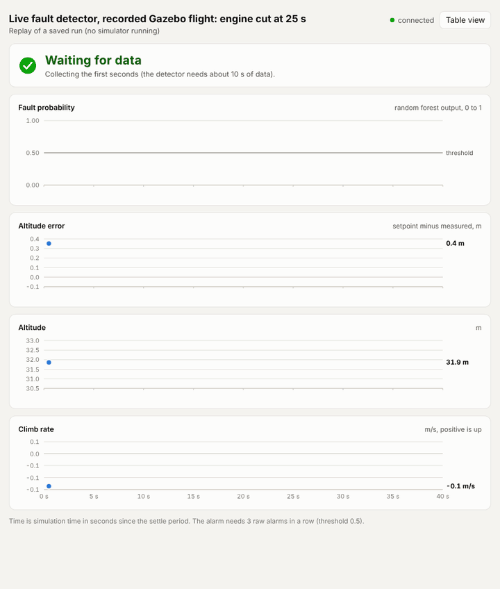
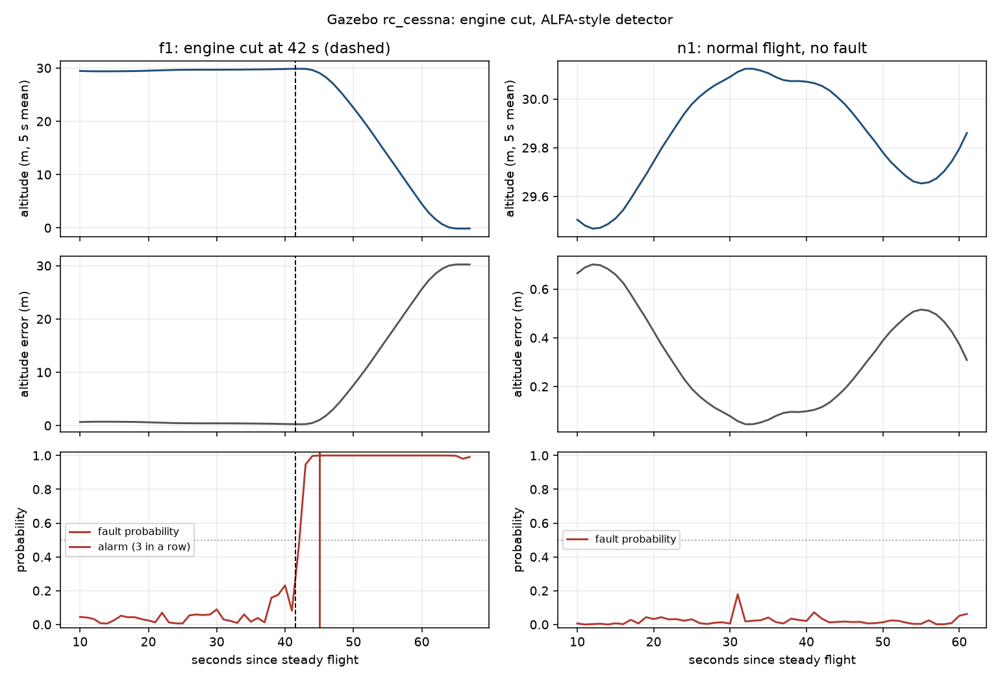
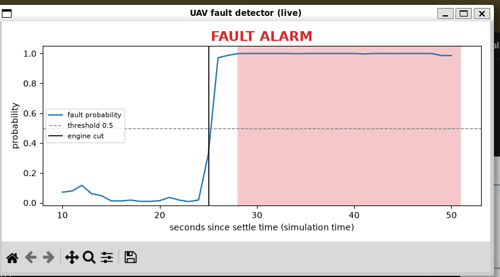

# px4-fault-detection-sim

[](https://github.com/PhamAnhHoangg/px4-fault-detection-sim/actions/workflows/ci.yml)

Status (2026-11-21): tested on 18 flights in PX4's built-in simulator (SIH) and 18 flights in PX4 with Gazebo Harmonic (3D, rc_cessna): normal flights, engine cuts and elevator faults. It also runs live next to the plane with a browser dashboard (five live Gazebo flights, alarm 1.8 to about 4 s after the fault, no false alarms). Simulation only: no real flight data from this setup yet.

A test harness that runs a UAV fault detector on PX4 simulated flights, cuts the engine at a known time, and measures how well the detector finds it. The detector follows the method of the separate project [alfa-fault-detection](https://github.com/PhamAnhHoangg/alfa-fault-detection).




*Replay of a real live run in Gazebo (`results/gazebo/live_engine_demo.csv`), made with `scripts/live/make_demo_gif.py`. Engine cut at 25.4 s, alarm at 28 s, no alarm before the cut, plane on the ground about 20 s later.*

## What works today

| Part | State |
| --- | --- |
| PX4 v1.17.0 SIH fixed-wing, hands-off takeoff and loiter | works, 12 flights recorded |
| Engine fault in SIH (set `SIH_T_MAX` to 0) | works |
| Per-second feature table from the ULog, ALFA-style windows | works |
| Leave-one-flight-out evaluation, alarm after 3 in a row | works |
| PX4 + Gazebo Harmonic, rc_cessna flown by hand (WSL2, Ubuntu 24.04) | confirmed by hand on 2026-11-20 |
| Engine fault in Gazebo (set `FW_THR_MIN` and `FW_THR_MAX` to 0) | confirmed by hand, see below |
| Scripted Gazebo flights (`scripts/gazebo/run_flight_gz.sh`, version 3, batch `record_set.sh`) | works, 12 flights recorded on 2026-11-20 (6 normal, 6 engine cut) |
| Detector on the 12 Gazebo flights | works, see results below |
| Experimental, parked: vision detector from an onboard camera (`scripts/vision`, [docs/VISION.md](docs/VISION.md)) | OpenCV part tested on synthetic frames only; not part of the results |
| Elevator fault and transfer between fault types | SIH and Gazebo, 18 flights each (2026-11-21), see below |
| Noise robustness | SIH only |
| Browser dashboard of the live signals (`scripts/live/dashboard.py`) | works in SIH and in replay (2026-11-20); Gazebo and Windows browser not checked |
| Detector running live while the plane flies (`scripts/live/live_detector.py`) | works in SIH (checked against the flight log) and in one Gazebo flight with the plot window open (2026-11-20) |
| Elevator fault (`CA_SV_CS2_TRQ_P` set to 0), recorder and cross-fault test | scripts written, not flown yet |
| ROS 2 node | not built |

## Results (SIH, 12 flights)


- 6 of 6 engine-cut flights detected, delay 1.4 to 2.4 s, median 1.9 s.
- 0 of 6 normal flights raised an alarm. No false-alarm seconds before any fault.
- Each flight was scored while left out of training (split by flight, never by row).
- Per-flight numbers: [results/sih/summary.csv](results/sih/summary.csv).

How to read this: it shows the method works on PX4 flight logs. It is not a benchmark.

- The task is easy. After the engine cut the plane sinks and the altitude error grows fast, and the flights are clean and similar.
- The sample is small (12 flights).
- The forest was retrained on these simulated flights. It is not the trained model from the ALFA project, which is not in this repo.
- Only the engine fault is injected. Control-surface faults are not done.
- The simulated plane is not the aircraft behind the ALFA data, so scores here say nothing about real-flight scores.
- The features are a simplified version of the ALFA ones: altitude error, altitude, climb rate, cross-track error to the loiter circle, and roll, pitch and yaw gaps between setpoint and estimate, each as 5 s mean, 5 s standard deviation and 10 s change.

## Results (Gazebo rc_cessna, 12 flights)



- 6 of 6 engine-cut flights detected, delay 2.1 to 3.5 s, median 2.65 s.
- 0 of 6 normal flights raised an alarm. No false-alarm seconds before any fault (31 to 39 s of clean flight before each cut).
- Same method and settings as the SIH run (threshold 0.5, alarm after 3 raw alarms in a row, leave-one-flight-out). Nothing was tuned on these flights.
- The delay is a little longer than in SIH (median 1.9 s). The cause has not been looked into.
- Per-flight numbers: [results/gazebo/r_gz_summary.csv](results/gazebo/r_gz_summary.csv). The feature table is [results/gazebo/table_gz.csv](results/gazebo/table_gz.csv).

The same caveats as for SIH apply: small sample, one airframe, one fault type, retrained forest and not the ALFA model. The engine cut is a throttle cap (`FW_THR_MAX` 0), because `failure motor off` has no effect. Takeoff altitude (25 to 40 m), loiter radius (70 to 120 m) and the time of the cut vary between flights, little else does.

## Gazebo, confirmed by hand

On 2026-11-20, in a separate WSL2 Ubuntu 24.04 distro with PX4 v1.17.0:

- `make px4_sitl gz_rc_cessna` starts, the plane takes off with `commander takeoff` and circles at 30 m at about 15 m/s.
- `failure motor off` is accepted by PX4 but changes nothing for this plane: altitude and speed stayed the same over 60 simulated seconds. The same was seen in SIH.
- Setting `FW_THR_MIN` and `FW_THR_MAX` to 0 does cut the power: the speed fell from about 15 to about 7 m/s and the plane lost height (30 m down to about 11 m in the reading taken).
- A plane landed with `commander land` can tip over on touchdown, and PX4 then refuses to arm until the simulator is restarted.

This part was typed by hand on one flight, and no flight log from it is in this repo. The scripted flights above repeat it. Setup notes and the problems met are in [docs/RUN_GAZEBO.md](docs/RUN_GAZEBO.md).

## Reproduce the SIH results

Needs a PX4 v1.17.0 build (`make px4_sitl_default`) and Python with `pip install -r requirements.txt`.

```
PX4_DIR=~/PX4-Autopilot OUT=./out scripts/sih/run_flight.sh n4 28 110 none 55   # normal flight
PX4_DIR=~/PX4-Autopilot OUT=./out scripts/sih/run_flight.sh f4 28 110 engine 55  # engine cut
python scripts/build_table.py out/table.csv out/n*.ulg out/f*.ulg
python scripts/detect_eval.py out/table.csv out/r
python scripts/plot_demo.py out/r_probs.csv f1 n1 out/demo.png
```

The arguments are: name, takeoff altitude, loiter radius, fault, seconds before the fault. The recorded set used `n4 28 110`, `n5 32 95`, `n6 25 120` and the matching `f` flights with the same numbers and fault times of 55, 42 and 48 seconds. The settings of the first six flights (n1 to n3, f1 to f3) were not written down. Flight logs are about 40 MB each and are not committed.

## Elevator fault in Gazebo (rc_cessna, 2026-11-21)

Six flights with `CA_SV_CS2_TRQ_P` set to 0 (`scripts/gazebo/record_set_elevator.sh`), same heights, circles and steady times as the 12 earlier Gazebo flights. In Gazebo this fault is mild: in the live test flight the height only swung 1 to 2 m around the target with a slow up-and-down motion, and the plane stayed flyable (in SIH it climbed about 20 m).

| Test | Detected | Median delay | False alarms |
| --- | --- | --- | --- |
| Trained on normal + engine cut, tested on elevator (never seen) | 6 / 6 | 1.85 s | none before the fault |
| Trained on normal + elevator, tested on engine cut | 6 / 6 | 2.65 s | none before the fault |
| Leave-one-flight-out on all 18 flights | 12 / 12 | 2.05 s | 0 / 6 normal flights |
| Live, engine-trained model, one elevator flight with the dashboard | alarm 1.8 s after the cut | | none before the cut, 10 of 10 samples per second |

Same pattern as in SIH, in a second simulator with a much smaller visible effect. Limits stay the same: 6 flights per fault, no wind, sudden faults, and only two fault types.

## Elevator fault and noise (SIH, 2026-11-21)

Elevator fault: `CA_SV_CS1_TRQ_P` set to 0, so the control allocator stops moving the elevator (control surface 1 in SIH airframe 10041; in the Gazebo Cessna it is surface 2). Six flights (`scripts/sih/run_flight.sh eN ... elevator ...`). The plane stays flyable: it pitches up, climbs about 20 m above its target height, slows from 14 to 9 m/s and settles. An engine cut does the opposite (the plane sinks below the target).

| Test | Detected | Median delay | False alarms |
| --- | --- | --- | --- |
| Trained on normal + engine cut, tested on elevator (never seen) | 6 / 6 | 1.65 s | none before the fault |
| Trained on normal + elevator, tested on engine cut | 6 / 6 | 2.4 s | none before the fault |
| Leave-one-flight-out on all 18 flights (both faults in training) | 12 / 12 | 1.75 s | 0 / 6 normal flights |

The detector transfers between the two faults because the strongest features describe how unsteady pitch and altitude become (pitch gap spread, 10 s altitude change, climb rate), not the direction of the change. Limits: one simulator, 6 flights per fault, no wind, and both faults are large and sudden. A smaller or slower fault would be a harder test.

Noise test: `NOISE=k python scripts/build_table.py ...` adds white noise per second to the signals (at k = 1: altitude 1 m, climb rate 0.3 m/s, loiter distance 1.5 m, attitude 0.6 degrees), then the same leave-one-flight-out evaluation on the 12 engine-cut set.

| Noise k | Detected | Median delay | False alarms |
| --- | --- | --- | --- |
| 0 | 6 / 6 | 1.9 s | 0 |
| 1 | 6 / 6 | 2.4 s | 0 |
| 2 | 6 / 6 | 2.5 s | 0 |
| 4 | 6 / 6 | 4.1 s | 0 |
| 8 | 6 / 6 | 7.6 s | 1 normal flight |
| 16 | 4 / 6 | 9.2 s | 1 second before a cut |

Training and testing use the same noise level. White noise per second is a simple model; real GPS error drifts slowly, which may be harder. Files: `results/sih/noise_summary.csv`, `cross_train_*.csv`, `loo_engine_and_elevator_summary.csv`, `table_sih_18.csv`.

## Live detector (new, SIH tested)

`scripts/live/live_detector.py` connects to a running PX4 simulation over MAVLink, builds the same per-second features as `build_table.py`, runs the saved forest every second and shows the fault probability and the alarm in a window. It can also cut the engine for you at a chosen second and puts the parameters back afterwards.

Train the model once on a feature table, then start the simulator, start the script, and take off:

```
python scripts/live/train_model.py out/table_gz.csv out/model_gz.joblib
# terminal 1: make px4_sitl gz_rc_cessna      (in pxh: param set NAV_DLL_ACT 0, then commander takeoff)
# terminal 2:
python scripts/live/live_detector.py --model out/model_gz.joblib --cut-at 25 --fault FW_THR_MIN=0 --fault FW_THR_MAX=0
```

Start the script before `commander takeoff`. It skips the first 30 s after arming (same as the table), so the probability starts at about 40 s into the flight (30 s of settling plus 10 s of window). `--png file.png` saves the plot instead of opening a window, `--csv file.csv` logs one row per second.

What was checked: in SIH, a new flight ran through the script. The engine cut was set at t = 25 s and the alarm came 2 s later with no alarm before the cut. The per-second signals match the ones computed from the flight log of the same flight (the offset is under one second, because the script finds the arming moment from the heartbeat). 

Two Gazebo flights so far (rc_cessna, model trained on the 12 Gazebo flights, plot window open on WSLg). In both the engine cut was set at t = 25 s and there was no alarm before it:

| Flight | First alarm | Delay after the cut |
| --- | --- | --- |
| live 1 | t = 29 s | 4 s |
| live 2 | t = 28 s | 3 s |

The offline median delay is 2.65 s. The probability stayed below 0.3 before the cut and was above 0.97 one to two seconds after it. Two flights show the live path works and say nothing about reliability. The screenshot is from live 2. The window needs `sudo apt install python3-tk` on WSL.

Lost data: in the two flights above only 5 to 7 of the 10 altitude messages per second reached the script (the `n=` column) while the plot window was open, because the window refresh held up the reading. The script now reads MAVLink in a background thread. In a test with an artificially slow window (SIH, virtual screen) the old script dropped to 0 to 4 samples per second and the new one kept all 10. Confirmed on WSLg on 2026-11-21 with the browser dashboard (`--no-plot`): 10 of 10 samples every second. Not yet re-checked with the plot window open.

Notes:
- The model that is saved was trained on all flights of the table, so its score on those flights means nothing. The honest numbers are the leave-one-flight-out ones above.
- Altitude error is the position setpoint altitude minus measured altitude. The MAVLink message that would carry PX4's own value (`NAV_CONTROLLER_OUTPUT`) is not sent by PX4 v1.17 in these simulations. In steady loiter the two are the same setpoint.
- PX4 remembers parameters between runs. The script restores the engine parameters when it ends normally. If it is killed hard, check `FW_THR_MAX` yourself.

## Live dashboard (new)

`scripts/live/dashboard.py` is a small local web app that draws the same signals in a browser while the flight runs: fault probability with the 0.5 threshold, altitude error, altitude and vertical speed, plus a status banner (normal or fault alarm, with the alarm time) and a marker where the engine was cut. It opens a browser tab by itself (in WSL, the Windows browser; `--no-open` to skip) and moves to the next free port if the one you asked for is taken. Hover shows the values, "Table" shows the numbers, and it follows the light or dark setting of the browser. It uses only the Python standard library and needs no internet.

With the simulator (add `--serve` to the live detector, then open the address in the browser):

```
python scripts/live/live_detector.py --model out/model_gz.joblib --cut-at 25 --fault FW_THR_MIN=0 --fault FW_THR_MAX=0 --csv out/live3.csv --serve 8000 --no-plot
# open http://localhost:8000
```

Without the simulator, replay a recorded live run (loops, 20 times faster than real time by default):

```
python scripts/live/dashboard.py --replay results/sih/live_sih.csv --loop
```

What was checked: in the sandbox, a real SIH flight ran through `live_detector.py --serve`, and the page showed the alarm 3 s after the engine cut, with no alarm before it. Replay mode was checked in light, dark, hover and table view in headless Chrome. Not checked yet: Gazebo with the dashboard, and a Windows browser reaching WSL2 (if `localhost` does not work, add `--host 0.0.0.0`). The replay file is from SIH; a Gazebo one will replace it.

## Reproduce the Gazebo results

Needs PX4 v1.17.0 with Gazebo Harmonic (`make px4_sitl gz_rc_cessna` must start). Setup notes and the problems met are in [docs/RUN_GAZEBO.md](docs/RUN_GAZEBO.md).

```
PX4_DIR=~/PX4-Autopilot OUT=./out scripts/gazebo/record_set.sh   # about 25 minutes, 12 flights
SETTLE_S=30 python scripts/build_table.py out/table_gz.csv out/n?.ulg out/f?.ulg
python scripts/detect_eval.py out/table_gz.csv out/r_gz
python scripts/plot_demo.py out/r_gz_probs.csv f1 n1 out/demo_gz.png
```

Run it headless and leave the machine alone while it records. Check a flight with `python scripts/inspect_log.py out/f1.ulg`.

## Layout

```
scripts/
  build_table.py          ULog flights to a per-second feature table
  detect_eval.py          leave-one-flight-out random forest, delay and false alarms
  plot_demo.py            figure for one fault flight and one normal flight
  inspect_log.py          check what happened in a flight log (messages, parameters, height, speed, motor)
  sih/run_flight.sh       record one SIH flight (tested)
  gazebo/run_flight_gz.sh record one Gazebo flight
  gazebo/record_set.sh    record the 6 normal and 6 engine-cut Gazebo flights
  gazebo/record_set_elevator.sh   6 elevator-fault flights (not flown yet)
  cross_fault.py          train on one fault type, test on another
  vision/horizon.py       OpenCV horizon detection (tested on synthetic frames, see docs/VISION.md)
  vision/vision_detect.py vision alarm; vision/compare_alarms.py: vision vs telemetry
  vision/record_frames.py save Gazebo camera frames as PNG
sim/models/rc_cessna_cam/ the Cessna with a forward camera (used by sim.sh start gz_rc_cessna_cam)
sim/models/rc_cessna_chase/ the Cessna with a chase camera for demo videos (sim.sh start gz_rc_cessna_chase)
  live/make_side_by_side.py chase-camera frames and dashboard side by side, lined up by the simulation clock
  sim.sh                  start, stop and check the simulator in the background (one terminal)
  live/train_model.py     train the forest on a table and save it
  live/probe_stream.py    diagnostic: MAVLink message rates
  live/live_detector.py   live detector over MAVLink with plot window
  live/dashboard.py       browser dashboard (live with --serve, or replay of a CSV)
  live/dashboard.html     the dashboard page
tools/robotics-mcp/       MCP servers for PX4 (tested in SIH) and ROS 2 (tested against a stand-in) with ask and lazy permission modes and a shared safety layer
tools/screen-recorder-mcp/  MCP server to screenshot and record the screen or a window (tested on Linux, not yet on Windows)
results/sih/              summary, per-second probabilities, figure
results/gazebo/           feature table, summary, per-second probabilities, figure
docs/                     roadmap and Gazebo setup notes
```

## Next steps

See [docs/ROADMAP.md](docs/ROADMAP.md). The main goal now is to show the alarm live next to the plane in the 3D window.

## License and credits

License: MIT, see [LICENSE](LICENSE).
PX4 Autopilot, Gazebo and ROS 2 have their own licenses. The method follows the ALFA dataset (Keipour, Mousaei and Scherer, 2021).
