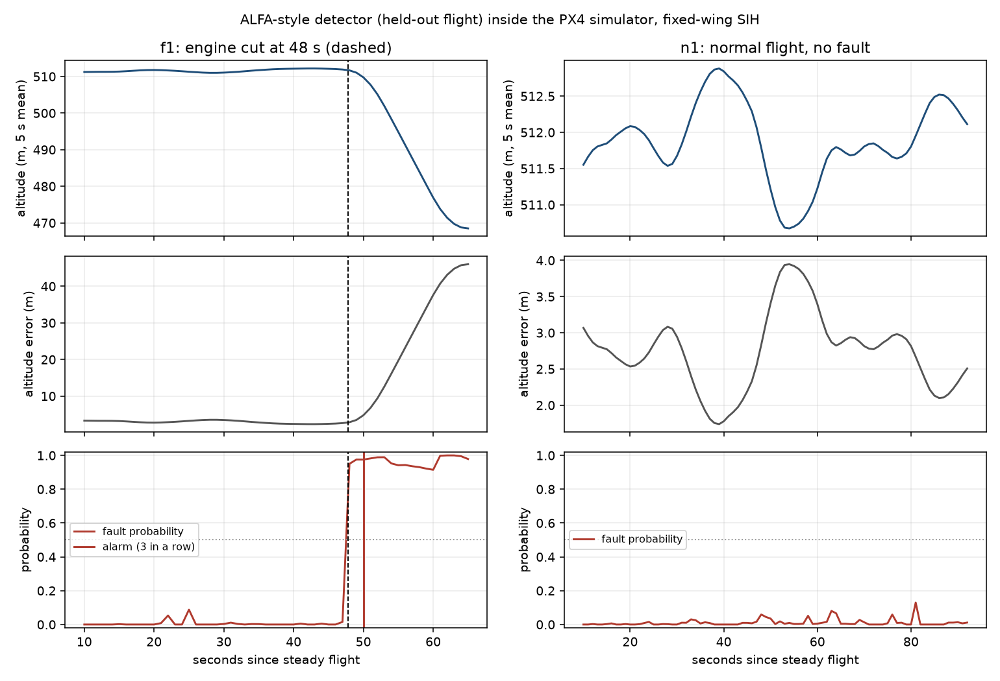

# px4-fault-detection-sim

Status: early. A small experiment works in PX4's built-in simulator (SIH). PX4 with Gazebo has been flown by hand, and the scripts for recording Gazebo flights are untested.

A test harness that runs a UAV fault detector on PX4 simulated flights, cuts the engine at a known time, and measures how well the detector finds it. The detector follows the method of the separate project [alfa-fault-detection](https://github.com/PhamAnhHoangg/alfa-fault-detection).

## What works today

| Part | State |
| --- | --- |
| PX4 v1.17.0 SIH fixed-wing, hands-off takeoff and loiter | works, 12 flights recorded |
| Engine fault in SIH (set `SIH_T_MAX` to 0) | works |
| Per-second feature table from the ULog, ALFA-style windows | works |
| Leave-one-flight-out evaluation, alarm after 3 in a row | works |
| PX4 + Gazebo Harmonic, rc_cessna flown by hand (WSL2, Ubuntu 24.04) | confirmed by hand on 2026-11-20 |
| Engine fault in Gazebo (set `FW_THR_MIN` and `FW_THR_MAX` to 0) | confirmed by hand, see below |
| Scripted Gazebo flights (`scripts/gazebo/run_flight_gz.sh`) | untested draft |
| Detector running live while the plane flies | not built |
| ROS 2 node | not built |

## Results (SIH, 12 flights)



- 6 of 6 engine-cut flights detected, delay 1.4 to 2.4 s, median 1.9 s.
- 0 of 6 normal flights raised an alarm. No false-alarm seconds before any fault.
- Each flight was scored while left out of training (split by flight, never by row).
- Per-flight numbers: [results/sih/summary.csv](results/sih/summary.csv).

How to read this: it shows the method works on PX4 flight logs. It is not a benchmark.

- The task is easy. After the engine cut the plane sinks and the altitude error grows fast, and the flights are clean and similar.
- The sample is small (12 flights).
- The forest was retrained on these simulated flights. It is not the trained model from the ALFA project, which is not in this repo.
- Only the engine fault is injected. Control-surface faults are not done.
- The simulated plane is not the aircraft behind the ALFA data, so scores here say nothing about real-flight scores.
- The features are a simplified version of the ALFA ones: altitude error, altitude, climb rate, cross-track error to the loiter circle, and roll, pitch and yaw gaps between setpoint and estimate, each as 5 s mean, 5 s standard deviation and 10 s change.

## Gazebo, confirmed by hand

On 2026-11-20, in a separate WSL2 Ubuntu 24.04 distro with PX4 v1.17.0:

- `make px4_sitl gz_rc_cessna` starts, the plane takes off with `commander takeoff` and circles at 30 m at about 15 m/s.
- `failure motor off` is accepted by PX4 but changes nothing for this plane: altitude and speed stayed the same over 60 simulated seconds. The same was seen in SIH.
- Setting `FW_THR_MIN` and `FW_THR_MAX` to 0 does cut the power: the speed fell from about 15 to about 7 m/s and the plane lost height (30 m down to about 11 m in the reading taken).
- A plane landed with `commander land` can tip over on touchdown, and PX4 then refuses to arm until the simulator is restarted.

This was typed by hand, one flight, and no flight log from it is in this repo. Setup notes and the problems met are in [docs/RUN_GAZEBO.md](docs/RUN_GAZEBO.md).

## Reproduce the SIH results

Needs a PX4 v1.17.0 build (`make px4_sitl_default`) and Python with `pip install -r requirements.txt`.

```
PX4_DIR=~/PX4-Autopilot OUT=./out scripts/sih/run_flight.sh n4 28 110 none 55   # normal flight
PX4_DIR=~/PX4-Autopilot OUT=./out scripts/sih/run_flight.sh f4 28 110 engine 55  # engine cut
python scripts/build_table.py out/table.csv out/n*.ulg out/f*.ulg
python scripts/detect_eval.py out/table.csv out/r
python scripts/plot_demo.py out/r_probs.csv f1 n1 out/demo.png
```

The arguments are: name, takeoff altitude, loiter radius, fault, seconds before the fault. The recorded set used `n4 28 110`, `n5 32 95`, `n6 25 120` and the matching `f` flights with the same numbers and fault times of 55, 42 and 48 seconds. The settings of the first six flights (n1 to n3, f1 to f3) were not written down. Flight logs are about 40 MB each and are not committed.

## Layout

```
scripts/
  build_table.py          ULog flights to a per-second feature table
  detect_eval.py          leave-one-flight-out random forest, delay and false alarms
  plot_demo.py            figure for one fault flight and one normal flight
  sih/run_flight.sh       record one SIH flight (tested)
  gazebo/run_flight_gz.sh record one Gazebo flight (untested draft)
results/sih/              summary, per-second probabilities, figure
docs/                     roadmap and Gazebo setup notes
```

## Next steps

See [docs/ROADMAP.md](docs/ROADMAP.md). The main goal is to record Gazebo flights, run the detector on them, and then show the alarm live next to the plane in the 3D window.

## License and credits

License: to be chosen.
PX4 Autopilot, Gazebo and ROS 2 have their own licenses. The method follows the ALFA dataset (Keipour, Mousaei and Scherer, 2021).
